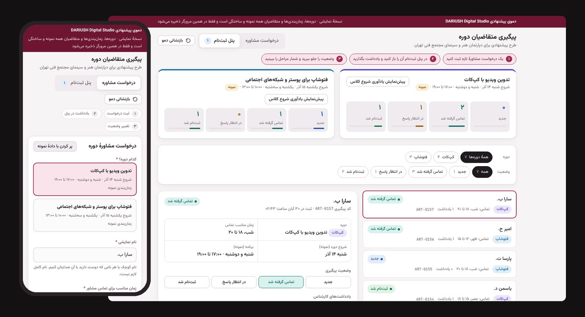

<div align="center">
  <h1>Course Applicant Tracking Demo</h1>
  <p><b>A Persian, right-to-left web demo for course consultation requests and applicant follow-up in an enrollment panel.</b></p>
  <p>Proposal demo by <b>DARIUSH Digital Studio</b> for the Art &amp; Cinema Department of <b>Tehran Technical Complex</b> · courses, schedules and applicants are samples</p>
  <p>
    <a href="https://dariush-tech.github.io/mft-course-applicants-demo/"><b>Live demo</b></a> ·
    <a href="#demo-flow">Demo flow</a> ·
    <a href="#run-locally">Run locally</a>
  </p>
  <p>
    
    
    
    
    
  </p>
  
</div>

<div dir="rtl">

### خلاصه

دموی پیشنهادی DARIUSH Digital Studio برای دپارتمان هنر و سینمای مجتمع فنی تهران. متقاضی برای دوره‌های فرضی کپ‌کات یا فتوشاپ درخواست مشاوره ثبت می‌کند (دوره، نام نمایشی، زمان مناسب تماس). کارشناس در پنل ثبت‌نام درخواست را می‌بیند، بر اساس دوره و وضعیت فیلتر می‌کند، یادداشت می‌گذارد و وضعیت را بین «جدید»، «تماس گرفته شد»، «در انتظار پاسخ» و «ثبت‌نام شد» تغییر می‌دهد. زمان‌بندی دوره‌ها صریحاً نمونه است و پرداخت یا ثبت‌نام رسمی در دمو وجود ندارد.

</div>

## Demo flow

1. **Request a consultation.** Pick a course (CapCut or Photoshop, both hypothetical), enter a display name and choose a contact window. A sample-data button fills the form. Submitting shows a tracking code such as `ART-0157`.
2. **Open it in the enrollment panel.** The new request is already there with the status *New*; the button on the success screen opens it directly. Add a note.
3. **Move it forward.** Switch the status between *New*, *Contacted*, *Awaiting reply* and *Enrolled*. The per-course stage counts update immediately.

A three-step guide under the header ticks off each step as the visitor completes it.

## Features

- **Sample course cards** with start date, days, time, number of sessions, level and room, each clearly labelled as a sample schedule.
- **Per-course stage counts.** Four stage tiles per course; tapping a tile filters the list to that course and stage.
- **Filters** by course and by status, with live counts.
- **Applicant detail** with course, contact window, sample schedule, status switch, timestamped notes and a change history.
- **Class-start reminder preview** per course, addressed to applicants marked *Enrolled*. Nothing is sent.
- **Local persistence and reset.** Everything is saved in `localStorage` and syncs across open tabs; the reset button restores the six sample applicants after an in-page confirmation.
- Persian calendar dates, light and dark themes, phone layouts and keyboard-accessible controls.

## Out of scope

- No payment and no official registration: *Enrolled* is a follow-up status only.
- No phone numbers or personal details; applicants are identified by a display name.

## Project structure

```
mft-course-applicants-demo/
├── index.html    # markup, styles and scripts (single file, no build step)
└── docs/         # README media
```

## Run locally

```bash
git clone https://github.com/dariush-tech/mft-course-applicants-demo.git
cd mft-course-applicants-demo
python3 -m http.server 8000
# open http://localhost:8000
```

---

Design & development: [Dariush Technology](https://github.com/dariush-tech) · DARIUSH Digital Studio
